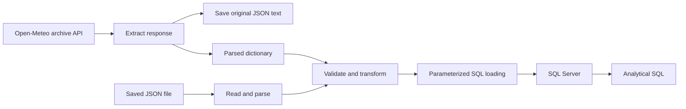

# Weather ETL Pipeline

A guided Python and SQL Server learning project that extracts historical weather for Cairo, preserves the source JSON, validates and transforms daily measurements, and loads them into a relational table for analysis.

The implementation uses small functions and a manual batch entry point. It does not require Docker, cloud services, pandas, or an orchestration platform.

Repository: [abdelrahman20044/weather-etl-pipeline](https://github.com/abdelrahman20044/weather-etl-pipeline).

## Data and scope

- Source: [Open-Meteo Historical Weather API](https://open-meteo.com/en/docs/historical-weather-api).
- Requested location: Cairo, latitude `30.0444`, longitude `31.2357`.
- Reanalysis model: `era5`.
- Time zone: `Africa/Cairo`.
- Current configured period: January 1–31, 2026, inclusive.
- Measurements: daily maximum/minimum temperature in Celsius and total precipitation in millimeters.
- Table grain: one record per city per local weather date.

These are historical **reanalysis estimates**, not future forecasts or direct readings from a particular weather station. Returned grid coordinates can differ slightly from requested coordinates. Historical source values may be revised; preserved raw files and the fixed test fixture retain the responses used by this project.

## Architecture



The pipeline saves the raw response before record validation. It then converts the parallel daily lists into dictionaries containing a Python `date` and numeric measurements. Database operations share one transaction per load call. Existing city/date keys are skipped; new records are committed together.

## Project structure

```text
.
├── README.md
├── ROADMAP.md
├── requirements.txt
├── .gitignore
├── .env.example                 # Shareable connection configuration template
├── .env                         # Local configuration; excluded from Git
├── src/
│   ├── __init__.py
│   ├── config.py                # API URL and request parameters
│   ├── extract.py               # HTTP request and JSON decoding
│   ├── raw_storage.py           # Exclusive file creation and text reading
│   ├── transform.py             # Record transformation and validation
│   ├── load.py                  # SQL existence checks, inserts, transaction
│   └── pipeline.py              # Entry point, replay option, run logging
├── sql/
│   ├── schema.sql               # Database, table, and constraints
│   └── analytics.sql            # January analytical queries
├── tests/
│   ├── fixtures/cairo_week.json # Fixed response for January 1–7, 2026
│   └── test_transform.py        # Four repeatable transformation tests
├── data/raw/                    # Runtime responses; excluded from Git
└── logs/pipeline.log            # Appended execution log; excluded from Git
```

The weekly fixture was copied once from an actual saved API response. It is committed with the tests, independently of runtime raw files. Do not regenerate it on every run.

## Requirements

- Windows and Python 3.12; developed and verified with Python 3.12.1.
- A running SQL Server instance and an account allowed to create the project database/table and read/write its data.
- The 64-bit [Microsoft ODBC Driver 17 for SQL Server](https://learn.microsoft.com/en-us/sql/connect/odbc/download-odbc-driver-for-sql-server), matching the configured driver name.
- SSMS or the SQL Server (`mssql`) extension in VS Code to execute setup and analysis scripts.
- Internet access for API runs; saved-file replay does not request the API but still needs SQL Server.

The current connection uses Windows Authentication. Python connects using the Windows identity of its process. No SQL password is required for this configuration.

## Setup

Run terminal commands from the project root, where `src/` and `requirements.txt` are located.

### 1. Create the Python environment

```powershell
python -m venv .venv
.\.venv\Scripts\python.exe -m pip install -r requirements.txt
```

If the environment's older bundled pip cannot validate your Windows certificate chain, an already up-to-date system pip can install into the target environment while using the system trust store:

```powershell
python -m pip --python .\.venv\Scripts\python.exe install -r requirements.txt
```

This alternative installs packages into `.venv`, not the system Python. Certificate verification remains enabled.

The commands below use the environment's interpreter explicitly, so activation is optional. In VS Code, select `.venv\Scripts\python.exe` through **Python: Select Interpreter**.

Dependencies are pinned in `requirements.txt`: `requests`, `pyodbc`, and `python-dotenv`. Standard-library modules such as `json`, `pathlib`, `logging`, and `unittest` do not require installation.

### 2. Create the database and table

Connect to your SQL Server in SSMS or the VS Code `mssql` extension, then execute `sql/schema.sql`.

The script creates `WeatherETL`, switches to it using `USE`, and creates `daily_weather`. `GO` separates client-side batches. Execute this setup once against an instance where these objects do not already exist; it is not an idempotent migration script. Do not rerun `CREATE DATABASE` or `CREATE TABLE` against existing project objects.

The setup script explicitly creates the table at `dbo.daily_weather`.

| Column | SQL type | Purpose |
|---|---|---|
| `city_code` | `VARCHAR(30) NOT NULL` | Stable city identifier |
| `weather_date` | `DATE NOT NULL` | Local weather date |
| `temperature_max_c` | `DECIMAL(5,2) NOT NULL` | Daily maximum temperature |
| `temperature_min_c` | `DECIMAL(5,2) NOT NULL` | Daily minimum temperature |
| `precipitation_mm` | `DECIMAL(8,2) NOT NULL` | Daily precipitation total |

The composite primary key is `(city_code, weather_date)`. CHECK constraints enforce nonnegative precipitation and minimum temperature not exceeding maximum temperature. Decimal columns store two fractional digits.

### 3. Configure the local connection

Copy the supplied template in the project root:

```powershell
Copy-Item .env.example .env
```

Edit `.env`, replacing `YOUR_SERVER` with the server/instance name used in your SQL client:

```dotenv
WEATHER_DB_CONNECTION="DRIVER={ODBC Driver 17 for SQL Server};SERVER=YOUR_SERVER;DATABASE=WeatherETL;Trusted_Connection=yes;"
```

`python-dotenv` loads this file on pipeline startup. An existing environment variable takes precedence over the file. A missing or blank setting stops execution. `.env` is excluded from Git; do not commit local connection credentials.

### 4. Review the API period

Edit `WEATHER_PARAMS` in `src/config.py`. The current January run uses:

```python
"start_date": "2026-01-01",
"end_date": "2026-01-31",
```

Keep `timezone="Africa/Cairo"`, `models="era5"`, and the requested daily variables for the current city and schema. City code and filenames are currently fixed to `cairo` in the pipeline; changing coordinates alone does not configure another city correctly.

## Run

### Fetch and load historical data

```powershell
.\.venv\Scripts\python.exe -m src.pipeline
```

The pipeline requests the configured period, saves JSON text under `data/raw/`, validates/transforms it, and loads new records. Filenames contain the city, requested dates, and a UTC extraction timestamp with microseconds:

```text
cairo_2026-01-01_2026-01-31_20261020T232400509159Z.json
```

Raw storage uses exclusive creation mode `x`: an existing filename raises an error instead of being overwritten. Files contain the decoded response text written in UTF-8, not a packet-level HTTP capture.

### Replay a saved response

```powershell
.\.venv\Scripts\python.exe -m src.pipeline --raw-file "data/raw/YOUR_SAVED_RESPONSE.json"
```

Replace the example filename with an existing raw file. Replay reads and parses that file, makes no API request, and does not save another raw copy. Relative input paths are resolved from the current working directory.

**The configured dates must match the file's coverage.** To replay `tests/fixtures/cairo_week.json`, first set `end_date` to `2026-01-07` in `src/config.py`; restore it to `2026-01-31` for monthly runs. Unit tests use their own explicit weekly dates and do not require this configuration change.

### Show command help

```powershell
.\.venv\Scripts\python.exe -m src.pipeline --help
```

Use module execution (`-m src.pipeline`) from the project root so imports such as `from src.extract import ...` resolve consistently.

## Validation and loading behavior

The transformation rejects:

- Invalid input types, empty city codes, and invalid or reversed date ranges.
- Missing or incorrect measurement units.
- Missing daily fields, non-list values, empty lists, and unequal lengths.
- Invalid, duplicate, or out-of-period dates and incomplete daily coverage.
- Missing, nonnumeric, boolean, NaN, or infinite measurements.
- Negative precipitation, temperatures outside the project's broad `[-100, 70]` Celsius limits, and minimum temperature exceeding maximum.

Zero precipitation is valid; it is not treated as missing. Transformation failure prevents the loading step from running. A raw file may already have been saved when validation fails.

For each validated record, the loader checks whether its city/date key exists. Existing keys are skipped; otherwise, values are bound to SQL `?` parameters. One commit follows the complete batch. A failure before commit triggers rollback of that transaction, while previous committed data remains. Cursors and connections are closed on normal and error paths.

Repeated loading does **not** update existing measurements, even if the API revises them. This is insert-and-skip behavior, not synchronization or an upsert. The MVP supports one pipeline process at a time; concurrent check-then-insert runs can race, although the primary key still prevents duplicate storage.

## Logs and errors

Pipeline logs go to the terminal and append to `logs/pipeline.log`. They include the period, source, raw path, transformation count, loading counters, and success or failure. Importing modules alone does not configure logging or start the pipeline.

Raw filename timestamps use UTC (`Z`). Logging timestamps use the execution machine's local time by default, so these displayed times can differ.

Example from verified January runs:

```text
Pipeline completed: inserted=24, skipped=7, raw_file=...json
Pipeline completed: inserted=0, skipped=31, raw_file=...json
```

The first example assumes the initial seven days already existed. An empty table should instead insert all 31 days. Run-specific timestamps and paths vary.

Runtime exceptions inside the pipeline execution boundary are logged with a traceback and exit code `1`; successful execution exits with `0`. HTTP requests use a timeout and `raise_for_status()`. There is no application-level retry policy. Logs are local diagnostic files and may contain detailed server error messages; review them before sharing.

## Tests and verification

Run the automated tests without API or SQL Server access:

```powershell
.\.venv\Scripts\python.exe -m unittest discover -s tests -v
```

The four persistent tests cover a valid week (row count and a mapped measurement), missing measurement, unequal list lengths, and duplicate date. Each test reloads the fixture in `setUp()` so test mutations are isolated.

Additional checks were performed during development, but are not a persistent integration-test suite:

- Compared every January SQL date and measurement with the saved monthly response: all 31 records matched.
- Repeated runs skipped all existing records.
- Used a unique temporary test city to verify first load, overlapping periods, and repeated-load counters.
- Forced a mid-batch CHECK failure and verified rollback left no new partial batch; removed temporary test rows afterward.
- Verified connection-failure logging through simulation and a missing-file pipeline run exiting with code `1`.

Setup was also verified in a newly created Python virtual environment with dependencies installed from `requirements.txt`, and a new temporary database on the existing SQL Server instance. The schema created the table, a saved monthly response inserted 31 records, replay skipped all 31, and all analytical queries executed. The temporary database was removed afterward. A different computer still needs its own SQL Server, driver, permissions, and `.env` configuration; that separate-machine installation has not been tested.

## SQL analysis

Connect your SQL client to `WeatherETL` and run `sql/analytics.sql`. It contains:

1. Daily row count for Cairo during January 2026.
2. Hottest date(s) using `TOP (1) WITH TIES`.
3. Average daily maximum temperature and total precipitation.
4. Change in daily maximum temperature using `LAG()`.
5. An alternative hottest-date query using `DENSE_RANK()`.

The average is the average of **daily maxima**, not mean daily temperature. `LAG` computes the predecessor in ascending date order; the current query displays rows in descending date order. January 1 has a NULL difference because there is no preceding row within the filtered period. City/date filters are applied before ranking.

Verified development-database results:

| Metric | Result |
|---|---|
| Days | 31 |
| Highest daily maximum | 27.70 °C |
| Hottest date | 2026-01-31 |
| Average daily maximum | 21.548387 °C |
| Total precipitation | 0.10 mm |

These results describe the preserved development data; a later source revision may differ. Rerunning the loader skips previously stored keys rather than replacing them.

## Troubleshooting

| Symptom | Check |
|---|---|
| `ModuleNotFoundError: src` | Run from the project root using `python -m src.pipeline` with the environment's interpreter. |
| `WEATHER_DB_CONNECTION is required` | Confirm `.env` is in the project root and the setting is nonblank. |
| Driver not found | Confirm the installed ODBC driver name and architecture match the connection configuration. |
| Login/server connection failure | Check SQL Server is running, the server name matches your SQL client, and the process's Windows identity has access. |
| HTTP timeout or certificate failure | Check connectivity and certificate trust; do not disable certificate verification to bypass the problem. |
| `FileExistsError` during raw saving | The destination already exists; preserve it and use a new filename. |
| Replay rejects missing days | Match the configured start/end dates to the saved file's coverage. |
| Missing file or malformed JSON | Verify the path and use a complete JSON response. |

## Learning and future work

`ROADMAP.md` records the guided stages and verification evidence. Core learning topics include HTTP/JSON, paths, functions and modules, data contracts, automated tests, ODBC connectivity, parameterized SQL, transactions, idempotency, logging, and analytical SQL.

Potential extensions include extracting validation helpers after expanding tests, configurable cities/dates, updated-record handling, retries, scheduling, and a persistent database integration-test suite. They are outside the current MVP.

Data attribution: weather data provided by [Open-Meteo](https://open-meteo.com/) using ERA5 reanalysis. Review the provider's [data sources and usage terms](https://open-meteo.com/en/docs/historical-weather-api) before redistributing or using the service beyond this learning project.
