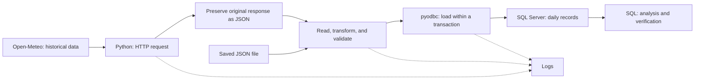

# Weather ETL Pipeline — Guided Learning Roadmap

## Learning agreement

This is a guided learning project. The learner writes the code; the mentor explains concepts, defines small tasks, reviews implementations, and helps verify results.

- Chat explanations: Egyptian Arabic, with technical terms in English.
- All project files, documentation, comments, error messages, and logs: English.
- The learner has studied Python and SQL conceptually and has Backend experience, but needs practical guidance with unfamiliar libraries and implementation.
- Work on one small task at a time. Explain the problem and concepts before assigning code.
- Give requirements and expected behavior, then let the learner attempt the implementation.
- Review actual bugs and distinguish required fixes from optional improvements.
- Use progressive hints: concept/direction, concrete approach, pseudocode or an isolated example, then a complete solution only on explicit request or after exhausting earlier hints.
- Start with a few essential tests. Introduce additional edge and failure cases progressively; the cases below are stage coverage goals, not the first assignment.
- Do not create or modify files without explicit approval. Do not silently rewrite learner code or create a large scaffold.
- At session start, identify the current stage, recap verified progress, and state the next concrete task.
- At meaningful milestones, ask one or two short understanding questions.
- At stage completion, review evidence, verify the Definition of Done, summarize learning, and request approval before updating this roadmap or moving forward.
- Never mark implementation complete merely because it ran once.

## Current status

- Roadmap approved and saved on 2026-10-11.
- Stage 0 completed with learner approval on 2026-10-11.
- Stage 1 completed with learner approval on 2026-10-12.
- Stage 2 completed with learner approval on 2026-10-15.
- Stage 3 completed with learner approval on 2026-10-16.
- Stage 4 completed with learner approval on 2026-10-19.
- Stage 5 completed with learner approval on 2026-10-19.
- Stage 6 completed with learner approval on 2026-10-21.
- Stage 7: README and setup verification are complete; repository publication is in progress with learner authorization.
- The end-to-end MVP, saved-file replay, logging, and analytical SQL are implemented and verified.

## 1. Project purpose and final outcome

Build a small Python batch program that fetches historical weather data for Cairo, preserves the original response, transforms it into validated daily records, and loads it into SQL Server for SQL analysis.

The Data Engineer's responsibilities are to understand source fields, preserve source evidence, detect invalid data, load safely, prevent duplicates, reconcile the destination with the source, and document execution and decisions.

Unlike a typical Backend request/response application, this program processes a dataset for a specified period and then finishes. HTTP, input validation, error handling, and persistence are familiar foundations from Backend development.

### Source and reproducibility

Use the [Open-Meteo Historical Weather API](https://open-meteo.com/en/docs/historical-weather-api). Its historical reanalysis data reconstructs past weather using observations and models. Describe records as historical reanalysis, not future forecasts or direct readings from a particular station.

| Setting | Proposed value |
|---|---|
| City | Cairo |
| Requested latitude | 30.0444 |
| Requested longitude | 31.2357 |
| Initial learning period | 2026-01-01 through 2026-01-07, inclusive |
| Final verification period | 2026-01-01 through 2026-01-31, inclusive |
| Model | Explicitly select `era5` |
| Time zone | Explicitly select `Africa/Cairo` |
| Variables | Daily maximum temperature, minimum temperature, precipitation total |
| Units | Celsius and millimeters |

A fixed historical period makes comparisons easier. Exact repeatable tests rely on a saved JSON fixture because the external source may revise its data.

### Source verification already performed during planning

A live read-only request on 2026-10-10 for the initial week returned:

- `daily_units` containing the units.
- `daily` containing parallel lists: `time`, `temperature_2m_max`, `temperature_2m_min`, and `precipitation_sum`.
- Seven elements in each list.
- First-day values: maximum 22.5 °C, minimum 12.5 °C, precipitation 0.0 mm.
- Returned coordinates 30.0 and 31.25, slightly different from the requested coordinates.

Each position across the parallel lists represents the same day. Verify equal lengths before combining them. Preserve source metadata and document that values represent the source-selected grid location. This planning check does not replace the learner's own inspection in Stage 1.

## 2. Final architecture



Reprocessing a saved file allows transformation and loading to be tested without network access.

### Proposed destination record

Finalize the schema in Stage 4 after the learner has inspected the response.

| Field | Meaning | Proposed SQL type |
|---|---|---|
| `city_code` | Stable identifier such as `cairo` | `VARCHAR(30)` |
| `weather_date` | Local date represented by the data | `DATE` |
| `temperature_max_c` | Daily maximum temperature | `DECIMAL(5,2)` |
| `temperature_min_c` | Daily minimum temperature | `DECIMAL(5,2)` |
| `precipitation_mm` | Daily precipitation total | `DECIMAL(8,2)` |

Grain: one row per city per day. Proposed composite key: `city_code`, `weather_date`.

## 3. MVP and optional improvements

### MVP

- One city, a fixed period, one table, and three weather variables.
- Manual terminal execution.
- Preserve the complete original response body before transformation.
- Transform using functions, lists, and dictionaries; no `pandas` required.
- Validate structure, units, dates, and values.
- Load using parameterized SQL and a transaction.
- Prevent duplicates on repeated execution.
- Produce useful logs and reproducible tests.
- Provide analytical SQL and a tested README.

### Quality and loading policies

- Missing values are not zero. Do not invent replacements for `null` measurements.
- Reject an invalid batch before loading, preserve raw evidence, and explain the reason.
- Loading succeeds completely or rolls back the batch's additions.
- Repeated loading skips existing records. Updating revised source values is outside the first version.
- Support one execution at a time. Concurrent execution is outside the MVP, while the database key still protects uniqueness.
- Document reasonable-value rules, including nonnegative precipitation, minimum temperature not exceeding maximum, and justified broad temperature limits.

### Optional improvements after MVP completion

- More cities or date ranges.
- Command-line options using `argparse`.
- Update existing records when the source revises values.
- Separate rejected-record storage.
- Limited retries with delays for transient failures.
- Incremental loading and local scheduling.
- Faster loading if data volume grows.

Avoid Spark, Kafka, Airflow, cloud infrastructure, microservices, unnecessary OOP, and Docker unless a concrete need emerges.

## 4. Ordered stages, dependencies, and effort

| Stage | Topic | Approximate effort | Prerequisite |
|---|---|---|---|
| 0 | Understanding and readiness | 1–2 hours | Roadmap approval |
| 1 | API extraction | 3–5 hours | Stage 0 |
| 2 | Raw storage and reading | 2–4 hours | Stage 1 |
| 3 | Transformation and validation | 5–8 hours | Stage 2 |
| 4 | SQL Server connection and loading | 5–8 hours | Stage 3 and SQL Server readiness |
| 5 | Reliability and data quality | 4–7 hours | Stage 4 |
| 6 | Integration, analytics, and verification | 4–6 hours | Stage 5 |
| 7 | Documentation and GitHub preparation | 3–5 hours | Stage 6 |

Total: approximately 27–45 focused hours, possibly more for setup and practice. These estimates are not deadlines.

Introduce timeout, basic validation, and transaction safety when first needed. Stage 5 completes and tests reliability practices rather than postponing their foundations.

## 5. Proposed final structure

Create files only when needed and approved; this is not an instruction to scaffold them now.

```text
weather-etl/
├── ROADMAP.md
├── README.md
├── requirements.txt
├── .gitignore
├── src/
│   ├── __init__.py
│   ├── config.py
│   ├── extract.py
│   ├── raw_storage.py
│   ├── transform.py
│   ├── load.py
│   └── pipeline.py
├── sql/
│   ├── schema.sql
│   └── analytics.sql
├── tests/
│   ├── fixtures/
│   │   └── cairo_week.json
│   ├── test_transform.py
│   └── test_pipeline.py
├── data/
│   └── raw/
└── logs/
```

Exclude runtime raw files, logs, and `.venv` from Git. Retain a small documented fixture in `tests/fixtures`. Read connection settings from environment variables; do not store secrets in code or Git.

## 6. Detailed stages

### Stage 0 — Project understanding and readiness

**Goal and purpose:** Explain the data journey and each component's responsibility before coding.

**Concepts and prerequisites:** Previously studied: functions, dictionaries, exceptions, HTTP, and SQL. New: ETL, batch execution, grain, and raw versus analysis-ready data.

**Learning material:** Explain Extract, Transform, and Load using one day's data and relate them to API requests, validation, and persistence in Backend development. No additional course is needed.

**Tasks, in order:**

1. Task 0.1: Explain in your own words how one day's weather moves from the source to the table. No code is required.
2. Review Python, terminal, and SQL Server readiness, including the available connection method.
3. If needed, complete a small exercise using three dictionaries: extract dates and identify a missing value.

**Files and responsibilities:** Read this roadmap. Agree on an exercise location only if needed; do not create the full structure.

**Learner responsibilities:** Write the explanation and any exercise independently, then try running Python during the readiness task. The mentor reviews practical gaps.

**Testing and verification:** Distinguish raw from transformed data, historical records from forecasts, and explain why city plus date identifies one record. For an exercise, begin with valid and missing-data cases.

**Definition of Done:** Architecture understanding is demonstrated, Python is usable, and SQL Server's status is known with a defined setup plan.

**Learning outcomes:** Break the problem into small functions and explain the Data Engineer's role.

**Dependencies and effort:** Roadmap approval; approximately 1–2 hours.

### Stage 1 — Extracting data from the API

**Goal and purpose:** Write a Python request and inspect the response independently.

**Concepts and prerequisites:** Familiar: endpoints, query parameters, status codes, JSON. New: `requests.Response`, timeout, and JSON decoding into Python objects.

**Learning material:** Read the relevant request, parameters, JSON, and error sections of the [Requests guide](https://requests.readthedocs.io/en/latest/user/quickstart/) and the Open-Meteo field documentation. Successful JSON decoding does not prove HTTP success.

**Tasks, in order:**

1. Set up `.venv`, select the interpreter, and install the library with practical guidance.
2. Build the Cairo-week request parameters in a dictionary.
3. Write an extraction function with timeout and HTTP checking; inspect keys, units, and list lengths.

**Files and responsibilities:** Gradually create `src/extract.py` for requests, `src/config.py` for shared settings, `requirements.txt`, `.gitignore`, and `src/__init__.py`.

**Learner responsibilities:** Write the request, function, and inspection code from requirements and expected behavior, not a complete supplied implementation.

**Testing and verification:** Start with a successful seven-day response and an invalid parameter. Progressively simulate timeout and invalid JSON without arbitrary repeated requests.

**Definition of Done:** Request is repeatable, parameters are clear, HTTP errors are not accepted as successful data, and the learner can locate every required field.

**Learning outcomes:** Write a similar API request and use documentation without copying an example verbatim.

**Dependencies and effort:** Stage 0 complete; approximately 3–5 hours.

### Stage 2 — Preserving raw data

**Goal and purpose:** Preserve the original response and reread it without another API request.

**Concepts and prerequisites:** Familiar: files and JSON. New: `pathlib`, project-relative paths, and original response body versus reconstructed JSON.

**Learning material:** Raw data is evidence for debugging transformations. Read small relevant sections of Python's `pathlib` and `json` documentation.

**Tasks, in order:**

1. Choose filenames identifying city, period, and extraction time without overwriting old copies.
2. Save the original JSON response body as received by the program, before cleaning.
3. Read the file into a Python object and prepare a fixed weekly test fixture.

**Files and responsibilities:** `src/raw_storage.py` handles saving/reading; `data/raw` stores runtime output; `tests/fixtures/cairo_week.json` is the fixed sample. Adjust extraction only as necessary to expose the original response.

**Learner responsibilities:** Write save/read functions and explain the naming convention.

**Testing and verification:** Start with save/read comparison and a missing file. Progressively test directory creation, malformed JSON, and safely simulated write failure.

**Definition of Done:** No fields are lost, old raw files are not overwritten, rereading yields expected data, and file errors are clear.

**Learning outcomes:** Separate network problems from processing problems and explain source preservation.

**Dependencies and effort:** Stage 1 complete; approximately 2–4 hours.

### Stage 3 — Transformation and validation

**Goal and purpose:** Convert parallel lists into valid daily records without losing or inventing data.

**Concepts and prerequisites:** Familiar: lists, dictionaries, loops, functions. New: `datetime.date`, a data contract, functions independent of external systems, and `unittest`.

**Learning material:** Unequal parallel lists can silently lose data when an approach stops at the shortest list. Use small examples and the basics of [unittest](https://docs.python.org/3/library/unittest.html).

**Tasks, in order:**

1. Verify required sections, fields, units, and equal list lengths.
2. Convert each position into a city/date/measurement record with suitable Python types.
3. Validate the requested period, unique dates, daily coverage, missing values, numeric and finite measurements, and value relationships.

**Files and responsibilities:** `src/transform.py` contains transformation and validation; `tests/test_transform.py` verifies them.

**Learner responsibilities:** Write the functions, quality rules, and tests with readable names and clear rejection reasons.

**Testing and verification:** Begin with the valid seven-day fixture, one missing value, and unequal list lengths. Add one-day data, empty lists, missing fields, wrong units, invalid/duplicate/out-of-range dates, missing days, strings or `bool` instead of numbers, nonfinite values, negative precipitation, and minimum exceeding maximum progressively.

**Definition of Done:** Valid sample yields seven correct records; invalid cases fail clearly; input is unchanged; tests run without network or SQL Server.

**Learning outcomes:** Write a testable transformation and distinguish a correct type from an acceptable value.

**Dependencies and effort:** Stage 2 complete; approximately 5–8 hours.

### Stage 4 — Connecting and loading into SQL Server

**Goal and purpose:** Persist validated Python records safely in a suitable relational table.

**Concepts and prerequisites:** Familiar: SQL types, keys, constraints, and `INSERT`. New: `pyodbc`, ODBC driver, connection string, cursor, parameter binding, and Python-managed transactions.

**Learning material:** `pyodbc` is the Python interface; the driver is a separate SQL Server connectivity component. Read the [pyodbc Windows guide](https://github.com/mkleehammer/pyodbc/wiki/Connecting-to-SQL-Server-from-Windows) and [Microsoft driver documentation](https://learn.microsoft.com/en-us/sql/connect/odbc/download-odbc-driver-for-sql-server). Determine authentication and connection settings from the actual environment.

**Tasks, in order:**

1. Verify connectivity and read settings from environment variables.
2. Write the schema with suitable types, a composite key, `NOT NULL`, and `CHECK` constraints.
3. Write parameterized loading with commit, rollback, and resource cleanup.

**Files and responsibilities:** `sql/schema.sql` defines the table; `src/load.py` loads records; update `config.py` and `requirements.txt`.

**Learner responsibilities:** Write SQL and connection/loading functions; explain types and constraints. Do not insert values directly into SQL text.

**Testing and verification:** Begin with successful connection, one valid insert, and reading it back. Progressively load seven records, test missing settings and wrong server, reject constraint violations, compare dates/values, and demonstrate rollback after mid-batch failure.

**Definition of Done:** Valid records load accurately, constraints work, failure leaves no partial batch, and no secrets are stored in project files.

**Learning outcomes:** Explain a value's journey from a dictionary to a SQL column and the roles of parameters and transactions.

**Dependencies and effort:** Stage 3 complete and SQL Server ready; approximately 5–8 hours.

### Stage 5 — Reliability and data quality

**Goal and purpose:** Make reruns safe and failures understandable and traceable.

**Concepts and prerequisites:** Familiar: exceptions and Backend error handling. New: idempotency, execution counters, logging, and error-handling boundaries.

**Learning material:** Duplicate prevention needs defined loading behavior and a database constraint. Logs explain stage, outcome, and cause rather than merely printing values.

**Tasks, in order:**

1. Skip existing records while retaining database-key protection.
2. Log start/end, period, counts, and raw file path.
3. Handle errors at appropriate boundaries and provide an explicit unsuccessful exit on failure.

**Files and responsibilities:** Update extraction, storage, transformation, and loading modules; begin `src/pipeline.py` for execution and logging. Runtime logs belong in `logs`.

**Learner responsibilities:** Write rerun behavior, log messages, and error handling; distinguish existing records from connection failures.

**Testing and verification:** Begin with loading the same fixture twice. Then test overlapping periods, mid-batch failure, invalid data before loading, and absence of sensitive connection information in logs.

**Definition of Done:** Second run adds zero records, overlaps add only new days, failure rolls back additions and reports its cause, and no misleading success is logged.

**Learning outcomes:** Explain and demonstrate idempotency and locate failures using logs.

**Dependencies and effort:** Stage 4 complete; approximately 4–7 hours.

### Stage 6 — Integration, analytics, and final verification

**Goal and purpose:** Run the whole pipeline and provide evidence that its output is correct.

**Concepts and prerequisites:** Familiar: aggregations, CTEs, window functions. New: integration testing, reconciliation, and execution success versus data correctness.

**Learning material:** Distinguish independent unit tests, SQL Server integration tests, and full runs involving the source. Practice `GROUP BY` and `LAG` with meaningful questions.

**Tasks, in order:**

1. Complete extract → save → read → transform → load coordination.
2. Support reprocessing a saved file and run the full January period.
3. Write and verify queries for highest temperature, average daily maximum temperature, precipitation total, and daily change using `LAG`.

**Files and responsibilities:** `src/pipeline.py` coordinates existing functions; `sql/analytics.sql` holds queries; `tests/test_pipeline.py` covers suitable execution paths and failures.

**Learner responsibilities:** Write coordination, queries, and verification plan. Explain why average daily maximum temperature differs from average temperature throughout a day.

**Testing and verification:** With an initially empty test table, load the week to reach 7 rows, then January to add 24 and reach 31, then rerun January to add zero. Compare dates and measurement values, not only counts. Progressively test malformed JSON, unavailable database, and loading failure. Keep test data isolated from any unrelated tables.

**Definition of Done:** API and saved-file execution work, counts and values reconcile, reruns are safe, selected failure tests pass, and query interpretations are accurate.

**Learning outcomes:** Explain the full path and demonstrate how correctness was established.

**Dependencies and effort:** Stage 5 complete; approximately 4–6 hours.

### Stage 7 — Documentation and GitHub preparation

**Goal and purpose:** Let another person understand and run the project, and prepare the learner to explain it in an interview.

**Concepts and prerequisites:** Familiar: Git and GitHub. New: reproducible setup instructions, source traceability, documented quality decisions and limitations.

**Learning material:** Review README essentials: problem, architecture, setup, execution, tests, real output examples, decisions, and limitations.

**Tasks, in order:**

1. Write the README, documenting Python, dependencies, SQL Server, driver, and settings.
2. Add real execution examples, fixture provenance, historical-data interpretation, and units.
3. Review Git contents, try setup in a fresh environment, and prepare publication.

**Files and responsibilities:** Write `README.md`; update `requirements.txt` and `.gitignore`. Update roadmap progress only after evidence review and learner approval.

**Learner responsibilities:** Write the draft and decision explanations in their own words. The mentor reviews clarity and accuracy. Actual GitHub publication requires the learner's direction.

**Testing and verification:** Follow setup from the beginning, run tests, review excluded files and absence of secrets, and ensure examples come from real execution.

**Definition of Done:** Instructions are tested, decisions and limitations are clear, files are ready for GitHub, and the learner can explain design, duplicates, quality, and failure handling without reading all the code.

**Learning outcomes:** Present and discuss the project, and plan a similar pipeline for another source.

**Dependencies and effort:** Stage 6 complete; approximately 3–5 hours.

## 7. Concepts practiced and new tools

| Area | Previously studied concepts to practice | New tools or concepts |
|---|---|---|
| Python | Functions, imports, collections, files, JSON, exceptions | `requests`, `pathlib`, `datetime`, `logging`, `unittest`, `.venv` |
| SQL | Types, keys, constraints, inserts, aggregations, window functions | Python connectivity, parameter binding, transaction management |
| Configuration | Separating settings from logic | Environment variables through `os` |
| Connectivity | Database experience | `pyodbc` and an ODBC driver |
| Data Engineering | Decomposition and validation | Raw data, grain, contracts, idempotency, reprocessing, reconciliation |

Introduce tools only when needed. Environment variables are sufficient initially; no additional `.env` library is required.

## 8. Task review and progress tracking

For each small task:

1. Explain the problem and relevant concept.
2. Define requirements and expected behavior.
3. Let the learner implement it.
4. Review actual bugs, required fixes, and optional improvements.
5. Verify essential cases first, then progressively add relevant edge/failure cases.
6. Check completion criteria before assigning the next task.

Stage completion requires reviewed implementation, test evidence, an understanding check, and learner approval before recording completion or advancing.

### Progress checklist

- [x] Approve the roadmap and save `ROADMAP.md` in English.
- [x] Stage 0: Demonstrate architecture understanding and establish tool readiness.
- [x] Stage 1: Write, understand, and test API extraction.
- [x] Stage 2: Preserve and reread raw data.
- [x] Stage 3: Implement transformation, validation, and independent tests.
- [x] Stage 4: Implement schema, connectivity, and safe loading.
- [x] Stage 5: Verify idempotency, logs, and failure behavior.
- [x] Stage 6: Complete integration, reconciliation, and analytics.
- [ ] Stage 7: Test documentation and prepare files for GitHub.

### Stage completion evidence

Stage 0 — completed on 2026-10-11 with learner approval:

- Learner reported Python 3.12.1; mentor created `.venv` and verified its Python 3.12.1 executable and pip.
- Learner selected the `.venv` interpreter in VS Code and demonstrated understanding of environment isolation and terminal activation.
- Learner confirmed SQL Server is available and has been used successfully; Python-to-database connectivity remains a Stage 4 check.
- Reviewed HTTP extraction, raw preservation, transformation/validation, and SQL loading responsibilities.
- Clarified rejection before loading versus rollback after database changes begin, and the project's missing-value policy.
- Learner explained comparison with preserved raw data and reprocessing; mentor clarified that the transformation bug must be fixed before rerunning.
- No pipeline code was written during this stage.

Stage 1 — completed on 2026-10-12 with learner approval:

- Created and verified the project virtual environment, then installed `requests==2.34.2` and recorded it in `requirements.txt`.
- Learner built an Open-Meteo Historical Weather API request for Cairo covering 2026-01-01 through 2026-01-07 with ERA5, daily maximum/minimum temperature, daily precipitation, and the Africa/Cairo time zone.
- A successful live request returned seven dates and seven values for every requested measurement list; the learner inspected the nested JSON structure and units.
- Added a 10-second timeout and `raise_for_status()`. An intentionally misspelled daily field produced the expected HTTP 400 / `requests.exceptions.HTTPError`, then the valid parameter was restored.
- Learner implemented `fetch_weather_data(url, params)`, understood return values, and used an `if __name__ == "__main__"` guard to prevent requests during imports.
- Moved request settings to `src/config.py`, imported them into `src/extract.py`, and verified that importing `src.extract` does not execute the live request.
- Added `src/__init__.py`, switched to package imports, and successfully ran the extractor as `python -m src.extract` from the project root.
- Added a minimal `.gitignore` for the virtual environment, Python caches, local secrets, raw runtime data, and logs.
- Deferred timeout and invalid-JSON simulations until reliability/error-handling work is introduced progressively.

Stage 2 — completed on 2026-10-15 with learner approval:

- Implemented `save_raw_json()` and `read_raw_json()` using `pathlib`, UTF-8, parent-directory creation, and text file operations.
- Anchored the raw directory to the project location using `__file__`.
- Used exclusive creation mode `x` to prevent overwriting raw files; an existing destination produced `FileExistsError` as expected.
- Generated filenames containing city, requested period, and a UTC extraction timestamp with microseconds.
- Saved a live API response and verified text equality after reading and dictionary equality after `json.loads()`; both comparisons returned True.
- Learner demonstrated the expected `FileNotFoundError` for a missing file and `JSONDecodeError` for invalid JSON text.
- Copied one preserved response to `tests/fixtures/cairo_week.json` once, verified matching SHA256 hashes, and confirmed seven elements in all daily lists for 2026-01-01 through 2026-01-07.
- Learner explained raw text versus parsed dictionaries, paths and parent directories, memory versus disk, and the purpose of a fixed test fixture.
- Active project periods use 2026 at the learner's request. The 2024 source check above remains historical planning evidence.

Stage 3 — completed on 2026-10-16 with learner approval:

- Implemented `transform_weather_data(data, city_code, start_date, end_date)` to convert parallel daily lists into one record per city/date without modifying the source.
- Converted dates to Python `date` values; validated input structure, units, required lists, equal lengths, nonempty data, city code, and requested period.
- Rejected missing, boolean, non-finite, and out-of-range measurements, negative precipitation, and minimum temperature exceeding maximum.
- Validated date types and values, rejected duplicates and dates outside the period, and checked complete daily coverage.
- Mentor completed routine validation conditions with explicit learner authorization and explained the added code.
- Verified fixture-to-record value mapping, source preservation, and selected failure cases locally without API calls.
- Learner implemented four persistent `unittest` tests: valid week with a value assertion, missing measurement, unequal lengths, and duplicate date.
- Verification: `.venv/Scripts/python.exe -m unittest discover -s tests -p test_transform.py -v` passed all four tests.
- Discussed parameters versus external variables, dictionary/list indexing, validation versus tests, `setUp`, assertions, and expected exceptions. Refactoring remains optional after tests.

Stage 4 — completed on 2026-10-19 with learner approval:

- Established SQL Server connectivity using pyodbc 5.3.0, the installed 64-bit ODBC Driver 17, and Windows Authentication.
- Created WeatherETL and dbo.daily_weather with suitable column types, NOT NULL, a composite primary key, and temperature/precipitation CHECK constraints.
- Implemented parameterized INSERT execution for each record, one commit after the batch, rollback on failure, and resource cleanup including partial connection initialization.
- Added python-dotenv 1.2.4 and local `.env` configuration using WEATHER_DB_CONNECTION, with a missing-setting check. The local `.env` file is excluded from Git.
- Verified all seven Cairo records in SQL Server against the saved fixture, comparing dates and every measurement.
- Verified real mid-batch rollback using a unique test city: the second INSERT violated the precipitation CHECK, no test rows remained, and the original Cairo records remained intact.
- Learner explained cursor execution, positional parameters, connection-level transactions, commit versus rollback, and cleanup behavior.

Stage 5 — completed on 2026-10-19 with learner approval:

- Added parameterized existence checks by city/date, skipped existing records, and returned inserted/skipped counters after commit. The database primary key remains the final uniqueness guard; concurrent runs remain outside the MVP.
- Added named logging, terminal/file handlers, input period and fixture path, loading start/completion counts, and exception logging.
- Verified two runs against the existing Cairo week both reported inserted=0 and skipped=7.
- Verified live isolated test-city loads: first load inserted three, overlapping load inserted two/skipped two, and rerun inserted zero/skipped five.
- Verified a later constraint failure rolled back the current batch while preserving earlier committed test rows; failure logs contained no misleading completion message.
- Simulated connection failure and verified failure logging without emitting the connection string. Confirmed normal execution messages were saved in logs/pipeline.log.
- Removed only the unique test-city rows after verification; existing Cairo records were preserved.
- Full-pipeline start/end and extraction/validation failure reporting will be connected in Stage 6 when the orchestration entry point is introduced.

Stage 6 — completed on 2026-10-21 with learner approval:

- Implemented `src.pipeline` to coordinate extraction, raw preservation, validation/transformation, and loading; added optional saved-file replay with `--raw-file` and CLI help.
- Added pipeline-wide logging and failure exit status with explicit learner authorization; verified CLI success/failure paths without extra API calls.
- Monthly execution added 24 days and skipped the existing seven; replay skipped all 31. Every stored date and measurement matched the preserved monthly response.
- Learner wrote analytical SQL for row counts, hottest dates with ties, monthly aggregates, daily maximum changes using LAG, and an alternative DENSE_RANK query.
- Executed all five analytical result sets against SQL Server and verified them against independent calculations. Results: 31 days; maximum 27.70 Celsius on 2026-01-31; average daily maximum 21.548387 Celsius; precipitation total 0.10 mm.
- Re-ran all four persistent unit tests and CLI help successfully.

Stage 7 — documentation and setup verification, publication in progress:

- Authored English README covering architecture, setup, SQL schema, local connection configuration, API/replay execution, logging, tests, analytical results, limitations, and troubleshooting.
- Added `.env.example`; excluded local `.env` variants, virtual environments, caches, raw runtime data, and logs from Git.
- Made the SQL setup explicitly target `dbo.daily_weather` for consistent setup across user default schemas.
- Installed all pinned dependencies in a fresh temporary virtual environment; all four tests, CLI help, and dependency consistency checks passed.
- Verified schema setup and full saved-file processing against a new uniquely named temporary SQL Server database: 31 inserts, then 31 skips, and all analytics executed. Removed that test database afterward without changing WeatherETL.
- GitHub publication was explicitly requested by the learner. GitHub repository: https://github.com/abdelrahman20044/weather-etl-pipeline (private).
- Separate-computer setup is not claimed; verification used a fresh Python environment and database on the same Windows machine.

Teaching pace: use a short explanation followed by a complete small task, learner implementation, and a combined review/test. Explain unfamiliar concepts before assigning code. The mentor creates requested files and runs terminal commands; the learner writes project code. Do not review retained comments unless they cause a functional issue.
